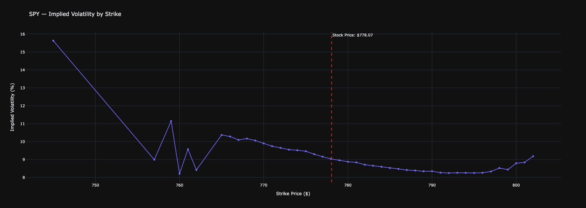
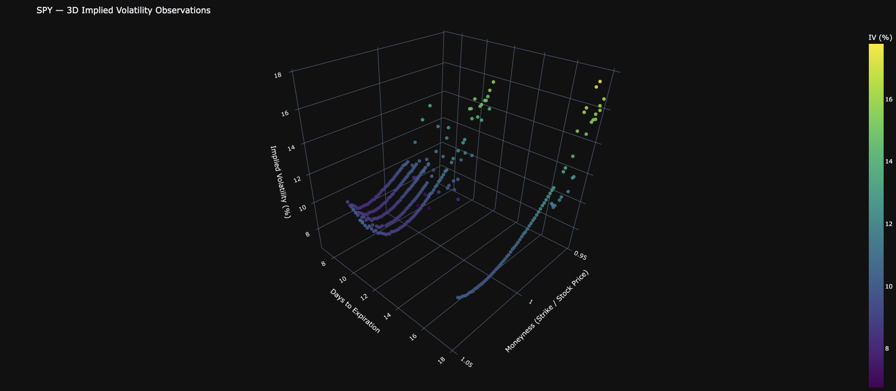
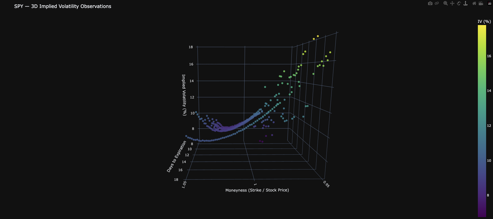

# Quant Options Engine

[](https://github.com/kyriakoscm7-crypto/quant-options-engine/actions/workflows/ci.yml)

**A Python-based quantitative options analytics platform featuring Black-Scholes-Merton pricing, analytical Greeks, implied volatility estimation, real market-data integration, and high-performance NumPy vectorization.**

Built using a modular architecture with a REST API, interactive volatility visualizations, automated testing, Docker containerization, and GitHub Actions continuous integration.

The project combines quantitative finance concepts with software engineering practices, emphasizing numerical correctness, reproducible performance measurements, and automated quality assurance.

## Project Highlights

| Metric | Result |
|---|---|
| Standalone Vectorized Pricing Throughput | **3.62 million options/second** |
| Standalone Pricing Speedup | **262.89× faster** |
| FastAPI Batch Pricing Throughput | **100,637 options/second** |
| FastAPI Batch Pricing Speedup | **50.19× faster** |
| Automated Tests | **209 passing** |
| Overall Code Coverage | **89%** |
| FastAPI Coverage | **97%** |
| Vectorized Pricing Module Coverage | **100%** |
| REST API Endpoints | **6** |
| Maximum Batch API Size | **10,000 contracts/request** |
| Continuous Integration | **GitHub Actions** |
| Containerization | **Docker** |
| API Framework | **FastAPI** |

Performance measurements were performed locally on an Apple Silicon MacBook Pro using Python 3.11.

The standalone pricing benchmark compares scalar and vectorized implementations of European call and put pricing.

The API benchmark compares repeated individual FastAPI requests against a single vectorized batch request.

**These benchmarks measure different workflows and should not be interpreted as equivalent performance measurements.**

---

## Features

### 1. Black-Scholes-Merton Options Pricing

Implements analytical pricing for European call and put options.

Features include:

- European call and put pricing.
- Continuous dividend yield support.
- Risk-free interest rate modeling.
- Input validation for invalid or non-finite parameters.
- Expiration and zero-volatility handling.
- Analytical option Greeks.
- Numerical consistency testing.

The original implementation provides a readable, object-oriented reference pricing engine.

### 2. High-Performance Vectorized Pricing

Implements a second Black-Scholes-Merton pricing engine using NumPy and SciPy.

Unlike the original implementation, which constructs a separate Python object for each option, the vectorized engine processes arrays of option parameters in batches.

Capabilities include:

- Batch European call and put pricing.
- NumPy broadcasting across input arrays.
- Support for varying strikes, maturities, volatility, and interest rates.
- Continuous dividend yields.
- Expired-option handling.
- Zero-volatility handling.
- Input validation across entire arrays.
- Numerical comparison against the original pricing engine.
- Integration with the FastAPI batch-pricing endpoint.

The vectorized implementation achieved a measured **262.89× speedup** when pricing 100,000 European option contracts in the standalone benchmark.

The optimized pricing engine is also accessible through the REST API.

### 3. Analytical Option Greeks

The original pricing engine calculates the following risk sensitivities:

| Greek | Description |
|---|---|
| Delta | Sensitivity to changes in the underlying asset price |
| Gamma | Sensitivity of delta to changes in the underlying price |
| Vega | Sensitivity to changes in volatility |
| Theta | Sensitivity to the passage of time |
| Rho | Sensitivity to changes in the risk-free interest rate |

The implementation uses the following conventions:

- Delta and gamma are expressed relative to a $1 underlying price movement.
- Vega measures sensitivity to a 1-percentage-point volatility change.
- Theta represents calendar-day time decay.
- Rho measures sensitivity to a 1-percentage-point interest rate change.

The vectorized engine currently calculates call and put prices. Analytical Greeks remain available through the original pricing engine.

### 4. Implied Volatility Estimation

Provides numerical implied volatility estimation from observed option prices.

Features include:

- Numerical root-finding.
- Pricing-bound validation.
- Numerical safeguards.
- Market-data-derived implied volatility estimates.
- Support for analyzing volatility across strikes and maturities.

### 5. Yahoo Finance Market Data

Integrates with Yahoo Finance through `yfinance` to retrieve option-chain observations.

Features include:

- SPY option-chain retrieval.
- Bid-ask quote filtering.
- Multiple-expiration data collection.
- Underlying-price observations.
- Option last-trade timestamps.
- Implied volatility estimation from filtered market observations.
- Preparation of datasets for volatility visualizations.

The market-data layer separates external data retrieval from the pricing and visualization components.

### 6. FastAPI REST API

Exposes quantitative pricing and market-data functionality through a REST API.

The application provides six endpoints:

| Method | Endpoint | Description |
|---|---|---|
| GET | `/health` | Application health monitoring |
| POST | `/api/v1/options/price` | Single-contract European call and put pricing |
| POST | `/api/v1/options/greeks` | Analytical option Greeks |
| POST | `/api/v1/options/implied-volatility` | Numerical implied volatility estimation |
| GET | `/api/v1/market/options/{ticker}` | Yahoo Finance option-chain market data |
| POST | `/api/v1/options/batch-price` | Vectorized pricing for up to 10,000 contracts |

Additional features include:

- JSON request and response handling.
- Automatic input validation using Pydantic.
- Interactive Swagger documentation.
- Automated endpoint tests.
- Numerical validation of batch-pricing results.
- Request-size restrictions for batch pricing.

#### Vectorized Batch Pricing API

The batch-pricing endpoint accepts between **1 and 10,000 European option contracts** in a single request.

Each contract is validated using the same financial input rules as the original single-option pricing endpoint.

After validation, the application converts the input parameters into NumPy arrays and performs vectorized call and put pricing.

The endpoint:

- Processes multiple contracts in one request.
- Supports different stock prices, strikes, maturities, rates, volatilities, and dividend yields.
- Preserves the original contract order.
- Returns European call and put prices rounded to four decimal places.
- Rejects empty batches and batches exceeding 10,000 contracts.
- Rejects invalid financial parameters with HTTP 422.
- Uses the existing vectorized pricing engine without duplicating its mathematical implementation.

A local benchmark demonstrated a **50.19× speedup** for 10,000 contracts compared with sending 10,000 individual requests through FastAPI's TestClient.

This improvement reflects the combined benefits of batching requests and using vectorized calculations.

### 7. Interactive Volatility Visualizations

Uses Plotly to visualize implied volatility across option strikes and expiration dates.

Includes:

- A 2D implied volatility smile.
- A 3D visualization of implied volatility across moneyness and maturity.
- Interactive tooltips.
- Market-data-derived observations.
- Multiple viewing perspectives.

---

## Performance Benchmarking

The project includes two complementary performance benchmarks:

1. **Standalone pricing benchmark:** Compares scalar and vectorized Python pricing workflows.
2. **FastAPI benchmark:** Compares repeated single-option API requests against one batch-pricing request.

Both benchmarks verify numerical consistency between the compared implementations.

### Benchmark 1: Standalone Pricing Engine

The original implementation calculates option prices individually using Python objects and scalar SciPy operations.

The optimized implementation uses NumPy arrays and vectorized mathematical operations to process large batches.

#### Methodology

Both implementations were evaluated using identical, deterministically generated option parameters.

The benchmark measures the complete workflow required to calculate both European call and put prices.

Three workloads were evaluated:

- 1,000 option contracts.
- 10,000 option contracts.
- 100,000 option contracts.

Each workload was repeated five times, with the median execution time used for comparison.

The benchmark also checks numerical consistency between the aggregate pricing results of both implementations.

The original implementation includes per-option object construction, while the vectorized implementation includes conversion of the generated input parameters into NumPy arrays.

This comparison represents two different end-to-end pricing workflows rather than an isolated comparison of mathematical functions.

#### Standalone Benchmark Results

| Options Priced | Original Engine | Vectorized Engine | Speedup |
|---|---:|---:|---:|
| 1,000 | 73.469 ms | 0.511 ms | **143.90×** |
| 10,000 | 731.115 ms | 3.087 ms | **236.80×** |
| 100,000 | 7,266.352 ms | 27.640 ms | **262.89×** |

#### Standalone Pricing Throughput

| Workload | Original Engine | Vectorized Engine |
|---|---:|---:|
| 1,000 options | 13,611 options/sec | 1,958,703 options/sec |
| 10,000 options | 13,678 options/sec | 3,238,955 options/sec |
| 100,000 options | 13,762 options/sec | **3,617,956 options/sec** |

#### Key Standalone Result

For 100,000 European option contracts:

**Original implementation:**

- Execution time: 7.266 seconds.
- Throughput: 13,762 options per second.

**Vectorized implementation:**

- Execution time: 0.02764 seconds.
- Throughput: 3,617,956 options per second.

**Measured improvement: 262.89× faster.**

This corresponds to an approximately **99.62% reduction in execution time** for the benchmarked workload.

These measurements apply to batch call-and-put pricing, not analytical Greeks, implied volatility estimation, or the complete market-data workflow.

---

### Benchmark 2: FastAPI Batch Pricing Performance

The second benchmark evaluates whether vectorized pricing provides a measurable performance improvement when accessed through the REST API.

Rather than comparing only mathematical functions, this benchmark compares two complete API workflows.

#### Workflow A: Individual API Requests

Each option contract is submitted separately to:

```text
POST /api/v1/options/price
```

For 10,000 contracts, the application processes 10,000 individual requests.

Each request includes:

- FastAPI request handling.
- Pydantic input validation.
- Scalar option pricing.
- Response construction.
- JSON serialization and decoding.

#### Workflow B: Vectorized Batch API Request

All option contracts are submitted together to:

```text
POST /api/v1/options/batch-price
```

For 10,000 contracts, the application processes one batch request.

The workflow includes:

- FastAPI request handling.
- Pydantic validation of all contracts.
- Conversion of contract parameters into NumPy arrays.
- Vectorized call and put pricing.
- Response construction.
- JSON serialization and decoding.

#### API Benchmark Methodology

The benchmark uses FastAPI's `TestClient` to execute the application directly within the Python process.

No separate Uvicorn server is required.

The benchmark:

1. Generates deterministic option parameters using a fixed random seed.
2. Uses identical contracts for both API workflows.
3. Warms up the endpoints before measuring performance.
4. Measures the elapsed time for each workflow.
5. Repeats each workload five times.
6. Uses median execution times to reduce sensitivity to timing fluctuations.
7. Verifies that individual and batch pricing results agree within the configured numerical tolerance.
8. Calculates speedup and option-pricing throughput.
9. Saves the measurements to a CSV file.

The workloads are:

- 100 contracts.
- 1,000 contracts.
- 10,000 contracts.

The benchmark uses sequential requests for the individual workflow.

It does not simulate concurrent clients or network traffic.

#### API Benchmark Results

| Options Priced | Individual API Requests | Single Batch API Request | Speedup |
|---|---:|---:|---:|
| 100 | 46.449 ms | 1.590 ms | **29.22×** |
| 1,000 | 457.218 ms | 10.029 ms | **45.59×** |
| 10,000 | 4,987.507 ms | 99.367 ms | **50.19×** |

#### API Pricing Throughput

| Workload | Individual API Requests | Batch API Request |
|---|---:|---:|
| 100 options | 2,153 options/sec | 62,905 options/sec |
| 1,000 options | 2,187 options/sec | 99,710 options/sec |
| 10,000 options | 2,005 options/sec | **100,637 options/sec** |

#### Key API Performance Result

For 10,000 European option contracts:

**Individual API requests:**

- Number of requests: 10,000.
- Execution time: 4.988 seconds.
- Throughput: 2,005 options per second.

**Vectorized batch API:**

- Number of requests: 1.
- Execution time: 0.099 seconds.
- Throughput: 100,637 options per second.

**Measured improvement: 50.19× faster.**

This represents an approximately **98.01% reduction in execution time** for the measured workflow.

The benchmark demonstrates that the batch API can process substantially more contracts per second than repeated sequential individual requests under the tested conditions.

#### Why the API Speedup Differs from the Standalone Speedup

The standalone benchmark achieved a 262.89× speedup.

The API benchmark achieved a 50.19× speedup.

These results are not contradictory.

The standalone benchmark primarily measures pricing workflow performance.

The API benchmark includes additional application overhead, including:

- Request routing.
- Pydantic validation.
- JSON processing.
- Response generation.
- TestClient request handling.

The API benchmark also compares one batch request against many separate requests, so its speedup reflects both request consolidation and vectorized pricing.

The results should not be interpreted as isolating the performance contribution of NumPy alone.

#### API Benchmark Limitations

The benchmark measures in-process FastAPI request handling using `TestClient`.

It does not include:

- Real network latency.
- Production Uvicorn server performance.
- Concurrent user traffic.
- Reverse proxies or load balancers.
- Cloud infrastructure.
- External market-data retrieval.
- Database operations.
- Production monitoring overhead.

The reported throughput is therefore **in-process benchmark throughput**, not a claim about production HTTP server capacity.

---

### Reproduce the Benchmarks

Run the original pricing benchmark:

```bash
python -m benchmarks.benchmark_black_scholes
```

Run the scalar-versus-vectorized pricing benchmark:

```bash
python -m benchmarks.benchmark_vectorized
```

Run the FastAPI performance benchmark:

```bash
python -m benchmarks.benchmark_api
```

The API benchmark runs directly against the FastAPI application using `TestClient`.

A separate server is not required.

The benchmark may take several minutes because it performs repeated individual API requests.

#### Benchmark Output Files

Results are saved to:

```text
benchmarks/results/
├── black_scholes_benchmark.csv
├── vectorized_comparison.csv
└── api_comparison.csv
```

The original benchmark measures call pricing, put pricing, and full valuation with analytical Greeks separately.

The vectorized comparison measures both call and put pricing together.

The API comparison measures the complete in-process request workflows.

Results depend on processor performance, installed dependencies, Python version, and system load.

---

## Visualizations

### 2D Implied Volatility Smile

The volatility smile displays implied volatility across option strikes using filtered SPY market-data observations.

This visualization helps illustrate how implied volatility varies across strike prices for a selected expiration.



### 3D Implied Volatility Visualization

The interactive 3D visualization displays observed implied volatility across:

- **Moneyness:** Strike price relative to the underlying price.
- **Time to expiration:** Remaining days until option expiration.
- **Implied volatility:** Volatility estimated from observed option prices.

Unlike an interpolated volatility surface, this visualization represents individual market-data observations.

The screenshots below show the visualization from different viewing angles.

**View 1 — Implied Volatility Across Moneyness and Maturity**



**View 2 — Alternative Perspective**



---

## Technology Stack

| Category | Technologies |
|---|---|
| Programming Language | Python 3.11 |
| Numerical Computing | NumPy, SciPy |
| Data Processing | pandas |
| Market Data | yfinance |
| REST API | FastAPI, Uvicorn |
| Data Validation | Pydantic |
| Visualization | Plotly |
| Automated Testing | pytest, pytest-cov |
| Code Quality | Ruff |
| Dependency Security | pip-audit |
| Containerization | Docker |
| Version Control | Git, GitHub |
| Continuous Integration | GitHub Actions |

---

## Project Architecture

The application follows a modular architecture that separates financial calculations, market-data retrieval, API functionality, and visualization.

### Pricing Layer

Responsible for:

- Scalar Black-Scholes-Merton pricing.
- Analytical Greeks.
- Implied volatility estimation.
- Vectorized batch pricing.

### Market-Data Layer

Responsible for:

- Yahoo Finance option-chain retrieval.
- Quote validation and filtering.
- Multiple-expiration data collection.
- Preparing market observations for analysis.

### API Layer

Responsible for:

- Exposing quantitative functionality through FastAPI.
- Validating incoming requests.
- Supporting single-contract and batch option pricing.
- Enforcing batch request-size limits.
- Returning structured JSON responses.
- Providing application health monitoring.

### Visualization Layer

Responsible for:

- Generating implied volatility smiles.
- Visualizing volatility across moneyness and maturity.
- Producing interactive Plotly figures.

### Benchmarking Layer

Responsible for:

- Measuring scalar pricing performance.
- Measuring vectorized pricing performance.
- Comparing individual and batch API workflows.
- Verifying numerical consistency during performance comparisons.
- Saving reproducible benchmark results.

### Testing and Infrastructure

Responsible for:

- Automated unit and integration-style tests.
- Numerical correctness checks.
- Batch API validation and response testing.
- Code coverage measurement.
- Static code-quality checks.
- Dependency vulnerability scanning.
- Docker image builds.
- Container smoke testing.
- Continuous integration.

---

## Project Structure

```text
quant-options-engine/
├── .github/
│   └── workflows/
│       └── ci.yml
│
├── app/
│   ├── __init__.py
│   │
│   ├── api/
│   │   ├── __init__.py
│   │   └── main.py
│   │
│   ├── market_data/
│   │   ├── __init__.py
│   │   ├── yahoo_client.py
│   │   └── multi_expiration.py
│   │
│   ├── pricing/
│   │   ├── __init__.py
│   │   ├── black_scholes.py
│   │   ├── implied_volatility.py
│   │   └── vectorized_black_scholes.py
│   │
│   └── visualization/
│       ├── __init__.py
│       ├── volatility_smile.py
│       └── volatility_surface_3d.py
│
├── benchmarks/
│   ├── benchmark_api.py
│   ├── benchmark_black_scholes.py
│   ├── benchmark_vectorized.py
│   └── results/
│       ├── api_comparison.csv
│       ├── black_scholes_benchmark.csv
│       └── vectorized_comparison.csv
│
├── docs/
│   └── images/
│       ├── volatility_smile.png
│       ├── volatility_surface_3d.png
│       └── volatility_surface_3d_2.png
│
├── tests/
│   ├── test_api.py
│   ├── test_batch_pricing_api.py
│   ├── test_black_scholes.py
│   ├── test_implied_volatility.py
│   ├── test_market_data.py
│   ├── test_multi_expiration.py
│   ├── test_multi_expiration_extended.py
│   ├── test_vectorized_black_scholes.py
│   ├── test_volatility_smile.py
│   ├── test_volatility_surface.py
│   └── test_yahoo_client_extended.py
│
├── .dockerignore
├── .gitignore
├── Dockerfile
├── README.md
├── requirements.txt
├── ruff.toml
└── volatility_surface.py
```

---

## Installation

### Prerequisites

- Python 3.11.
- Git.
- Docker (optional).

### 1. Clone the Repository

```bash
git clone https://github.com/kyriakoscm7-crypto/quant-options-engine.git
cd quant-options-engine
```

### 2. Create a Virtual Environment

**macOS or Linux:**

```bash
python3.11 -m venv .venv
source .venv/bin/activate
```

**Windows:**

```powershell
py -3.11 -m venv .venv
.venv\Scripts\Activate.ps1
```

### 3. Install Dependencies

```bash
python -m pip install -r requirements.txt
```

---

## Running the API

Start the FastAPI application:

```bash
uvicorn app.api.main:app --reload
```

Open the interactive API documentation:

**http://127.0.0.1:8000/docs**

The Swagger interface allows users to explore available endpoints, submit requests, and inspect responses.

If port 8000 is already in use, start the application on another port:

```bash
uvicorn app.api.main:app --reload --port 8001
```

Then open:

**http://127.0.0.1:8001/docs**

---

## Running with Docker

The application can also run inside a Docker container without requiring a local Python installation.

### 1. Build the Docker Image

```bash
docker build -t quant-options-engine .
```

### 2. Start the Container

```bash
docker run --rm -p 8080:8080 quant-options-engine
```

### 3. Access the API

Open:

**http://127.0.0.1:8080/docs**

To stop the container, press `Ctrl + C` in the terminal.

---

## Example: Black-Scholes-Merton Pricing

Consider a European option with the following parameters:

| Parameter | Symbol | Value |
|---|---|---|
| Underlying price | S | 100 |
| Strike price | K | 100 |
| Time to expiration | T | 1 year |
| Risk-free interest rate | r | 5% |
| Volatility | σ | 20% |
| Continuous dividend yield | q | 0% |

The Black-Scholes-Merton model produces approximately:

| Output | Value |
|---|---|
| European call price | 10.4506 |
| European put price | 5.5735 |
| Call delta | 0.6368 |
| Put delta | -0.3632 |

### Example API Request

Submit the following JSON to:

**POST `/api/v1/options/greeks`**

```json
{
  "S": 100,
  "K": 100,
  "T": 1,
  "r": 0.05,
  "sigma": 0.2,
  "q": 0
}
```

The API returns calculated option prices and risk sensitivities.

### Example: Vectorized Pricing in Python

The vectorized engine can price multiple contracts in a single operation.

```python
from app.pricing.vectorized_black_scholes import (
    price_options_vectorized,
)

strikes = [90, 95, 100, 105, 110]

calls, puts = price_options_vectorized(
    S=100,
    K=strikes,
    T=0.5,
    r=0.045,
    sigma=0.20,
    q=0.01,
)

print("Call prices:", calls)
print("Put prices:", puts)
```

NumPy broadcasting allows a single stock price, interest rate, or volatility value to be combined with arrays of strike prices and expiration times.

### Example: Vectorized Batch Pricing Through FastAPI

**Endpoint:**

```text
POST /api/v1/options/batch-price
```

The endpoint accepts between 1 and 10,000 contracts per request.

#### Example Request

```json
{
  "options": [
    {
      "S": 100,
      "K": 90,
      "T": 1,
      "r": 0.05,
      "sigma": 0.2,
      "q": 0
    },
    {
      "S": 100,
      "K": 100,
      "T": 1,
      "r": 0.05,
      "sigma": 0.2,
      "q": 0
    },
    {
      "S": 100,
      "K": 110,
      "T": 1,
      "r": 0.05,
      "sigma": 0.2,
      "q": 0
    }
  ]
}
```

#### Example Response

```json
{
  "count": 3,
  "results": [
    {
      "call_price": 16.6994,
      "put_price": 2.3101
    },
    {
      "call_price": 10.4506,
      "put_price": 5.5735
    },
    {
      "call_price": 6.0401,
      "put_price": 10.6753
    }
  ]
}
```

The example was verified locally using FastAPI's Swagger interface.

The API returned HTTP 200 with three option-pricing results.

Each result corresponds to the contract at the same position in the request.

#### Request Validation

The endpoint returns HTTP 422 when:

- The options list is empty.
- More than 10,000 contracts are submitted.
- A required contract parameter is missing.
- A stock price or strike price is nonpositive.
- Time to expiration or volatility is negative.
- A parameter is invalid or non-finite.
- Unexpected request fields are supplied.

Each contract is validated before the pricing operation begins.

---

## Automated Testing

The project includes **209 automated tests** covering quantitative calculations, market-data processing, API behavior, and visualizations.

The batch-pricing milestone introduced **37 additional tests**.

### Test Coverage

Latest verified local results:

| Component | Coverage |
|---|---:|
| FastAPI | **97%** |
| Yahoo Finance Client | 95% |
| Multiple-Expiration Processing | 90% |
| Original Black-Scholes Engine | 90% |
| Vectorized Black-Scholes Engine | **100%** |
| Implied Volatility Solver | 78% |
| Volatility Smile | 79% |
| 3D Volatility Visualization | 63% |
| **Overall** | **89%** |

The test suite covers:

- European call and put pricing.
- Analytical Greeks.
- Numerical pricing edge cases.
- Implied volatility estimation.
- Input validation and error handling.
- FastAPI endpoint behavior.
- Market-data processing and quote filtering.
- Multiple-expiration data retrieval.
- Volatility visualization generation.
- Vectorized batch pricing.
- NumPy broadcasting.
- Expired and zero-volatility options.
- Numerical agreement between scalar and vectorized pricing.
- Batch API request validation.
- Batch API response formatting.
- Preservation of contract order.
- Maximum batch-size enforcement.
- Consistency between single-contract and batch-pricing endpoints.

### Run Tests Locally

```bash
python -m pytest tests/ -q --cov=app --cov-report=term-missing
```

Latest verified local result:

```text
209 passed, 1 warning
TOTAL 490 54 89%
```

The warning originates from a Starlette dependency deprecation notice and does not indicate a failed test.

Code coverage measures which statements are executed during testing. It does not independently guarantee numerical correctness or complete financial-model validation.

---

## Code Quality and Security

The project uses automated checks to maintain code quality and identify dependency vulnerabilities.

### Ruff

Ruff performs static analysis and enforces consistent Python coding practices.

Run locally:

```bash
python -m ruff check app/ tests/ benchmarks/
```

Latest verified result:

```text
All checks passed!
```

### Dependency Security Scanning

The GitHub Actions workflow includes dependency vulnerability scanning using `pip-audit`.

This helps identify known security vulnerabilities in installed Python dependencies.

Security scanning does not guarantee that the application or its dependencies are free from vulnerabilities.

---

## Continuous Integration

The project uses GitHub Actions to automatically validate changes.

Workflow configuration:

```text
.github/workflows/ci.yml
```

Every push and pull request triggers two jobs.

### Python Quality, Tests, and Security

The workflow:

1. Checks out the repository.
2. Configures Python 3.11.
3. Installs project dependencies.
4. Runs Ruff code-quality checks.
5. Executes automated pytest tests.
6. Generates code coverage results.
7. Scans dependencies for known vulnerabilities.

### Docker Build and Smoke Test

The workflow:

1. Checks out the repository.
2. Builds the application's Docker image.
3. Starts the container.
4. Checks the application's `/health` endpoint.
5. Verifies that the containerized API responds successfully.

Both jobs have been successfully executed through GitHub Actions.

The workflow status is displayed at the top of this README.

---

## Quantitative Finance Concepts

### Black-Scholes-Merton Model

The Black-Scholes-Merton framework estimates theoretical European option prices using:

- Underlying asset price.
- Strike price.
- Time to expiration.
- Risk-free interest rate.
- Volatility.
- Continuous dividend yield.

The model assumes a particular stochastic process for the underlying asset and provides analytical European option pricing formulas.

### Option Greeks

Option Greeks quantify how theoretical option values respond to changes in market inputs.

They are useful for analyzing risk exposure and understanding the behavior of derivative prices.

### Implied Volatility

Implied volatility is the volatility parameter that makes a model's theoretical price equal an observed option price.

Because implied volatility generally cannot be isolated algebraically in the Black-Scholes-Merton formula, numerical root-finding methods are used.

### Volatility Smile

A volatility smile describes how implied volatility varies across strike prices for options sharing the same expiration.

### Volatility Across Maturities

Examining implied volatility across different expiration dates helps illustrate the term structure of implied volatility.

The project's 3D visualization combines strike-relative moneyness, time to expiration, and implied volatility into an interactive chart.

### Numerical Vectorization

Vectorization replaces repeated scalar Python operations with array-based numerical computations.

NumPy and SciPy perform many array operations using optimized numerical routines, reducing Python-level execution overhead.

In this project, vectorization substantially improves throughput for batch European option pricing.

The optimized calculations can be accessed directly through Python or through the FastAPI batch-pricing endpoint.

---

## Model Assumptions and Limitations

This project demonstrates quantitative modeling and software engineering techniques. Several limitations should be considered when interpreting its results.

### Black-Scholes-Merton Assumptions

- The underlying asset follows geometric Brownian motion.
- Volatility and the risk-free interest rate are assumed constant over the option's life.
- The model assumes continuous trading and frictionless markets.
- Analytical pricing formulas are designed for European-style exercise.

### American-Style SPY Options

SPY options are American-style and may be exercised before expiration.

The current implementation uses European Black-Scholes-Merton formulas when estimating prices and implied volatility.

Consequently, these estimates are approximations, particularly when early exercise is economically relevant.

### Dividend Yield

The pricing engines support continuous dividend yields.

The market-data implied volatility workflow may use a zero dividend yield unless a nonzero value is explicitly supplied.

This can introduce differences between theoretical model estimates and observed SPY option prices.

### Market-Data Quality

- Yahoo Finance data is retrieved using the unofficial `yfinance` interface.
- Option quotes may be delayed, stale, incomplete, or inconsistent.
- Bid-ask filtering improves quote selection but does not guarantee data quality.
- Option last-trade timestamps and underlying daily-price timestamps do not establish quote freshness.
- Market-data availability depends on the external provider.

### Volatility Visualization

The 3D chart displays observed implied volatility estimates as individual points.

It is not a calibrated, interpolated, or arbitrage-free volatility surface.

Observed volatility patterns may contain outliers caused by market-data limitations or pricing-model assumptions.

### Performance Benchmark Limitations

- Measurements were performed on a local Apple Silicon MacBook Pro.
- Results may vary with hardware, software versions, and system load.
- Benchmarks use generated option parameters rather than live trading workloads.
- The vectorized implementation calculates call and put prices, not analytical Greeks.
- Standalone pricing throughput excludes market-data retrieval, API overhead, and network latency.
- API benchmark throughput includes in-process request handling but excludes real network latency.
- The API benchmark uses sequential individual requests rather than concurrent clients.
- The scalar and vectorized implementations have different execution and memory-allocation characteristics.
- The batch API supports a maximum of 10,000 contracts per request.
- Performance results should not be interpreted as production trading-system throughput.

---

## Future Improvements

Potential future enhancements include:

- Extending vectorized calculations to analytical Greeks.
- Implementing Monte Carlo option pricing with statistical convergence analysis.
- Implementing American-style option pricing using binomial trees.
- Adding finite-difference pricing methods.
- Developing portfolio-level risk analytics and aggregate Greeks.
- Incorporating estimated dividend yields into market-data implied volatility calculations.
- Improving quote-quality filters and volatility outlier detection.
- Developing interpolated and calibrated volatility surfaces.
- Adding additional underlying assets and option types.
- Benchmarking performance under real HTTP traffic and concurrent workloads.
- Building an interactive web dashboard.
- Deploying the FastAPI application to a cloud platform.
- Adding structured logging and application monitoring.
- Introducing additional numerical performance optimizations.
- Implementing more advanced derivatives pricing models.

---

## Disclaimer

This project is intended for educational, research, and software engineering portfolio purposes.

It is not financial advice, an investment recommendation, or a production trading system.

Theoretical model outputs and market-data-derived estimates should not be relied upon for live trading decisions.