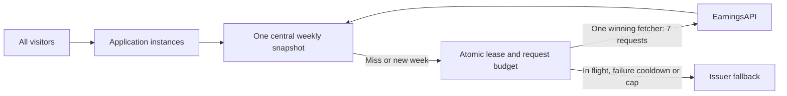

# EarningsAPI.com automatic calendar

The provider is **earningsapi.com**, not earningsapi.io. Its documented
[calendar endpoint](https://www.earningsapi.com/docs/calendar-earnings) accepts
one `date`; no date-range parameter is documented. A complete Monday–Sunday
week therefore needs seven requests. Documentation checked November 8, 2026.

Only one week is available: current week until Friday 16:00 America/New_York,
then next week throughout the weekend. DST follows the IANA timezone. The
cutoff is fixed at 16:00 even on holidays/early closes, as requested. Search
filters the loaded week locally. No week selector or refresh endpoint exists.
Research still passes the ticker to the existing Stock Explorer flow.

## Server configuration

Keep `EARNINGSAPI_API_KEY` in the server environment or untracked Streamlit
secrets. Never put it in GitHub, client code, screenshots or URLs shown to users.
The provider's documented authentication uses a query parameter; HTTP debug
logging or outbound proxy URL logging must redact `apikey`.

Set server environment variable or Streamlit secret `EARNINGSAPI_CACHE_PATH` to an SQLite file in a
private directory on a persistent volume, for example `/var/lib/qi/earnings.sqlite`.
Provision the directory with operator-only access. The app does not create the
volume or silently substitute temporary storage. Missing/unwritable storage
returns the curated issuer fallback without making provider requests. Do not
commit the database or include it in image builds, exports or backups.

The operator must ensure this volume survives restarts AND deployments. An
empty/replaced disk resets the ledger; the application cannot detect that.
Streamlit Community Cloud local files are not guaranteed persistent across
redeploys. For that environment, retain fallback or implement a genuinely shared
durable database before enabling provider access. No deployment was performed.

## Quota and concurrency

SQLite atomically reserves all seven requests BEFORE any HTTP call, with a
24-hour failure/in-flight cooldown per week, independent of successful cache lifetime. Other processes/visitors return the cache or fallback
while a batch is in flight. A killed process, invalid response, rejected key,
429 or network failure keeps that reservation. There are no immediate retries;
one later visit can retry after 24 hours. Partial weeks are withheld. A separate
250-request monthly reservation cap (New York calendar month) includes failed
batches and week rollovers. Other API consumers are outside this ledger.

A complete normalized week is shared for **up to seven days**, ending earlier
at the automatic Friday 16:00 ET reporting-week rollover. The first visit for the
new week fetches seven new dates; old-week entries are never relabeled or reused.
Snapshots loaded over the weekend therefore last until the following Friday.
The retrieval timestamp and schedule-change warning are visible above the cards;
the limitations panel shows expiry. This favors predictable quota over intraweek
schedule corrections; it is not live or company-confirmed data. No refresh button
or client TTL override can trigger another batch. Failed batches still retry on
the first visit after 24 hours, rather than waiting seven days.

Expired and previous-week payloads are cleared on the next calendar access;
no expired snapshot is displayed. Idle database files may still contain expired
bytes until cleanup; this is not a strict physical-deletion guarantee. No raw
responses, credentials, credential hashes, exceptions or request URLs are cached.
Only calendar visits call the provider. No background polling is added.

Processes on **one host sharing the same SQLite file** coordinate. Independent
Streamlit replicas with separate disks each have their own budget and can
multiply usage. Do not use this SQLite implementation on network filesystems;
use a transactional shared database for multiple hosts. All replicas using the
same provider key must share one ledger to enforce a true account-wide cap.

The documented free plan allows 60 requests/minute, 100/day and 1,000/month;
quotas reset in New York time. A single calendar ledger reserves at most 250/month
and normally uses seven per reporting week (roughly 28–35 per month), independent
of visitor count. A delayed first load, failures or a cold replacement disk can
change that estimate; 250 is the hard ledger ceiling, not the expected usage. Refreshing a
page, filtering, Research navigation and unrelated pages do not independently
spend quota. Provider schedules can change between weekly refreshes.

## Display rights and retention

[Provider terms](https://www.earningsapi.com/terms) permit retrieving and displaying
content in one's own application/website and prohibit republishing its proprietary
feed. They do **not** explicitly specify a caching duration or separately grant
permanent derived-data storage. The user-requested seven-day normalized display cache is an
implementation interpretation of that display permission, not a provider-stated
retention entitlement. No historical archive, downloadable feed or derived score
is created. The provider does not explicitly approve a seven-day cache in those terms; this
implementation does not assert such a grant. Confirm operational retention with
the provider when explicit contractual approval is required.

Provider dates/session categories are not issuer confirmation or exact release
times. As-of means retrieval time, not provider update time. Missing keys, storage,
quota or provider availability preserve the independently curated issuer schedule
for the same automatic week, with original source links and review dates.

## Verification

Offline unit tests cover calendar boundaries, DST, normalization, restart reuse,
concurrent calls, expired cache, failure cooldown and credential-safe results.
`qa/earnings_preview.py` and `qa/earnings_browser.py` exercise real Chromium using
synthetic data only; no live key or provider quota is needed. Authenticated live
provider behavior and actual hosting persistence have not been verified.

## Local Mac configuration

Alongside the API key in untracked `.streamlit/secrets.toml`, set an absolute
cache path in an existing private directory. For example, after creating
`/Users/YOUR_NAME/.quant-intelligence` with owner-only permissions:

```toml
EARNINGSAPI_CACHE_PATH = "/Users/YOUR_NAME/.quant-intelligence/earnings.sqlite"
```

Restart Streamlit after configuration changes. The environment takes precedence
when set. SQLite creates the database file, but not its parent directory. Reuse
this file across app restarts; deleting it removes the quota history. The database
must not be committed or copied between independently running hosts.

## Scaling to multiple servers (design, not deployed)



The implemented SQLite version coordinates processes on one host and persistent
local disk. A thousand users do not need a thousand calendars. It does not
protect a shared API key used by other machines or outside this application.
For AWS replicas, use one private PostgreSQL/RDS database with transactional
week leases and budget reservations, and the same normalized snapshot and
expiry rules. Store credentials in Secrets Manager; permit only the fetcher to
access the provider. Use CloudWatch for reservation counts, cache age, failures
and alarms; never log credential-bearing request URLs. Redis alone with an
expiring or evictable budget counter is insufficient for a durable monthly cap.

Do not horizontally scale the current SQLite app onto separate disks with the
same key. No AWS resources, cloud costs, scheduled jobs, Redis or distributed
quota backend were added or deployed by this change.

Tests include 1,000 cache hits across service instances/key rotation spanning
Saturday–Friday, concurrent requests sharing one batch, week rollover and cache
cleanup, DST expiry, 24-hour failure recovery, and persistent monthly exhaustion.
